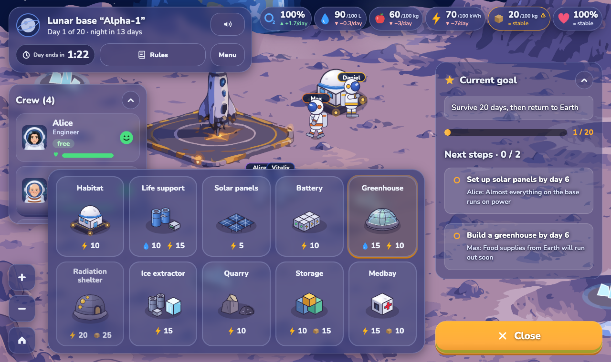
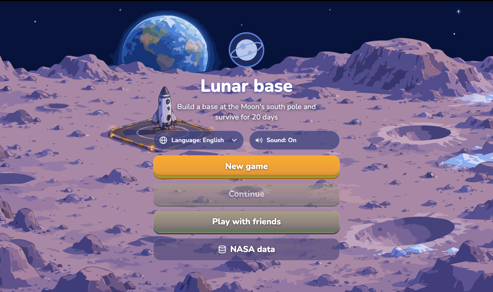
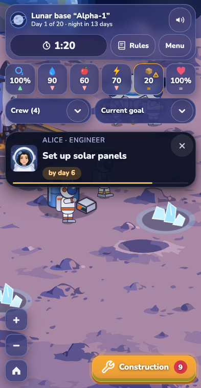

<div align="center">

# 🌕 Moonbase

### Build a base on the Moon. Keep four astronauts alive for 20 days. Learn real NASA science on the way.

**NASA Space Apps Hackathon 2026 · Team Qcold**

[](https://github.com/sohodolly/Qcold-team-Nasa-Hackathon2026-/actions/workflows/ci.yml)
[](https://nodejs.org/)
[](https://react.dev/)
[](https://www.typescriptlang.org/)
[](LICENSE)

### [▶ Play the live demo](https://sohodolly.github.io/Qcold-team-Nasa-Hackathon2026-/)



</div>

A kid-friendly, science-based survival strategy game about running the first permanent research base at the Moon's south pole. Real NASA data drives the events and the resource consumption. Play solo, or cooperatively with up to four friends in real time. The live demo is solo; cooperative mode needs the small Node server described below.

| 🛰️ Real NASA data | 👩‍🚀 A crew you care about | 🤝 Play together | 📱 Any screen |
| --- | --- | --- | --- |
| The day-9 solar flare is a real DONKI event. Oxygen, water and food needs come from NASA's ECLSS norms. | Four astronauts with professions, tasks, moods and illnesses that take them out of work. | Up to four players share one base, each with a role, with no desync thanks to a deterministic engine. | Desktop, tablet and phone in both orientations, in Ukrainian, Russian and English. |

<div align="center">

&nbsp;

</div>

### Run it in 30 seconds

```bash
npm install
```

```bash
npm run dev
```

Open <http://localhost:5173>. Needs Node.js 22+. Details, cooperative mode and tests are in [Quick start](#2-quick-start).

---

## Table of contents

1. [What is this project](#1-what-is-this-project)
2. [Quick start](#2-quick-start)
3. [How to play](#3-how-to-play)
4. [Everything that is built](#4-everything-that-is-built)
5. [NASA data: where it comes from and where it is used](#5-nasa-data-where-it-comes-from-and-where-it-is-used)
6. [Architecture](#6-architecture)
7. [Multiplayer](#7-multiplayer)
8. [Quality: tests, checks, CI](#8-quality-tests-checks-ci)
9. [Project structure](#9-project-structure)
10. [Scripts reference](#10-scripts-reference)
11. [Deployment](#11-deployment)
12. [Further documentation](#12-further-documentation)
13. [Team and license](#13-team-and-license)

---

## 1. What is this project

**Moonbase** is a browser game for children and curious adults. You command a 20-day mission at the lunar south pole with a crew of four astronauts. You have to build modules, keep oxygen, water, food, energy and crew health above zero, survive a real solar flare and the long lunar night, and bring everyone home on the rocket.

Why it exists:

- **Teach through play.** Every mechanic maps to something real: life support, solar power vs. lunar night, ice mining, radiation shelters, space weather, crew health in microgravity.
- **Use real data, not invented numbers.** The solar flare of the mission is a real event taken from NASA DONKI. Daily consumption of oxygen, water and food comes from NASA's ECLSS technical brief. Radiation comes from NASA RadLab. Nothing in `src/content/nasa/` is made up.
- **Work for a class or a family.** Up to four players share one base in real time, each with a different role.

The whole game runs in the browser. The only server is an optional ~300-line Node script for the cooperative mode.

---

## 2. Quick start

### Requirements

- **Node.js 22 or newer** (see `.nvmrc`; with nvm run `nvm use`)
- **npm 10 or newer**
- A modern browser (Chrome, Safari, Firefox, Edge)

### Install

```bash
git clone https://github.com/sohodolly/Qcold-team-Nasa-Hackathon2026-.git
cd Qcold-team-Nasa-Hackathon2026-
npm install
```

### Run the game (solo)

```bash
npm run dev
```

Open <http://localhost:5173>. Choose **New game**, pick a difficulty and play. Progress is saved in the browser (`localStorage`), so **Continue** brings you back.

### Run the game with friends (cooperative mode)

Start the game server in a second terminal, next to `npm run dev`:

```bash
npm run server
```

The server listens on port `8787` (override with `PORT=9000 npm run server`). Vite proxies `/api` to it, so nothing else is needed. Then, in each browser, choose **Play with friends**, type the same room name (Latin letters only, 1 to 20 characters) and press **Join**. Up to four players get different roles.

To play across a network, open `http://<your-computer-ip>:5173` on the other devices (start Vite with `npm run dev -- --host`).

### Production build

```bash
npm run build      # type-checks, then bundles into dist/
npm run preview    # serves dist/ locally
```

### Run the checks

```bash
npm run lint         # oxlint
npm run typecheck    # tsc -b
npm run check        # unit tests + multiplayer server tests + architecture rules
npm run golden       # 60 deterministic replays must match the stored baseline
```

For the browser end-to-end suite install the Playwright browser once:

```bash
npx playwright install chromium
E2E_PORT=5199 npm run e2e -- --workers=1
```

`E2E_PORT` picks the port for the test dev server (use a free one: Playwright refuses to start if the port is already taken).

### Keyboard shortcuts

| Key | Action |
| --- | --- |
| `B` | open or close the build menu |
| `R` | open or close the rules |
| `Esc` | close the rules, cancel placing a module or ice survey, close the build menu |

Shortcuts use physical keys, so they work on any keyboard layout.

---

## 3. How to play

**Goal:** keep the crew alive for **20 days**, then the rocket takes everyone home. If crew health reaches zero the mission fails.

**Time:** one game day lasts 90 seconds of real time. There is no pause and no fast-forward by design, so every minute matters (in cooperative mode the host's clock drives everyone).

**Resources** (top bar): oxygen, water, food, energy, health and materials. Each shows the current value, the capacity, and the per-day trend (it also differs between day and lunar night). Hover or tap for a plain-language explanation. When a stock hits its cap the tooltip says production is wasted.

**Building:** press the Build button (or `B`), pick a module, then click a highlighted tile near the base. Building takes one minute (half a day) and needs a free, healthy crew member of the right profession. Ten modules exist:

| Module | Role |
| --- | --- |
| Habitat | Living space for the crew |
| Life support | Produces oxygen, recycles water |
| Solar panels | Produce energy by day, nothing at night |
| Battery | Stores energy and releases it at night |
| Greenhouse | Produces food and oxygen, uses water |
| Radiation shelter | Protects from solar flares |
| Ice miner | Produces water |
| Rock quarry | Produces materials |
| Storage | Raises capacity |
| Medbay | Cheaper and faster treatment of illness |

**Crew:** four astronauts (Alice, Max, Vitaliy, Danilo) with specialities: engineer, scientist, doctor, technician. They ask for tasks ("Place solar panels"), get sick and cannot work while ill, and react with mood to your decisions. A sick astronaut is shown lying down on the map and cannot build or repair until they recover.

**Events:** equipment breakdowns, illness and the **solar flare on day 9** (parameters and date from NASA DONKI). Each event is a choice with trade-offs: hide in the shelter or keep working, repair now or later, treat or ignore.

**Lunar night:** from day 14 solar panels produce nothing. Only batteries keep the base alive, so plan for it.

**Research:** small mini-games (for example moon dust: shield or brush; ice scouting: ice or rock) teach a real fact and give a reward.

**Difficulty:** Easy, Normal and Hard change the starting stock and the consumption factor (0.75, 1, 1.25).

**Finale:** a 4-frame animated ending. Victory: the crew boards the rocket and flies home. Defeat: red alarm, the lights go out, the signal from Earth is lost and only a beacon blinks. After the ending you return to the main menu and can start a new mission.

---

## 4. Everything that is built

### Game design and mechanics

- 20-day mission, 90 s per day, 60 s per build, night from day 14.
- Ten module types with costs, per-day production and night-time behaviour in `src/content/modules.json`.
- Isometric tile map with terrain (landing pad, ice, rocks), a build zone around existing modules and a placement validator.
- Day and night cycle that changes production, shown live in the UI.
- Crew system: four astronauts with roles, tasks with deadlines, mood, illness (at most 3 per mission, at least 5 days apart) that makes a crew member unable to work for a time.
- Random events and decisions with consequences stored in the mission history.
- Real consumption model: crew needs per person come from NASA ECLSS norms (see section 5), scaled by difficulty and by activity (builders consume more oxygen than resting crew).
- Day summary after every day: what changed, what is late, what is at risk.
- Research mini-games.
- Score, grade, ranking of past runs saved locally.
- Final debrief generated from the mission history with NASA facts relevant to what actually happened.

### Visuals and audio

- Hand-drawn vector art for all 10 modules, astronauts, rocket and habitat, drawn as SVG with shared gradients.
- Astronauts walk between tasks, work, and lie down when ill. Name badges use each astronaut's suit colour.
- Moon landscape background (a 1.7 MB SVG rasterized once into a cached canvas, with recovery after tab suspension).
- Real photo-style crew portraits in the panels, event dialogs and task cards.
- Animated prologue story, rules screen, day banners, build progress, resource tooltips with trends.
- Two animated endings (victory and the four-frame defeat described above).
- Sound effects and ambience generated with the Web Audio API (no audio files), with a mute switch.
- Kid-friendly theme: large rounded controls, bright colours, "bounce" motion, reduced-motion support.

### Platforms and accessibility

- Desktop, laptop, tablet and phone in both portrait and landscape, each with its own HUD layout.
- Layout rules for narrow and short screens (build menu becomes a swipeable row, one task card at a time).
- iPhone safe areas (`viewport-fit=cover`) so there are no empty bars on notched devices.
- Keyboard controls, visible focus, ARIA roles and labels, automated accessibility checks with axe.
- Three languages: **Ukrainian, Russian, English**, switchable in the menu, with correct plural forms (`Intl.PluralRules`) and a typed key system.

### Multiplayer

- Built-in Node server with no dependencies (HTTP + Server-Sent Events).
- Rooms by name, up to four players with four different roles. A module of another role is locked with a clear message ("This is built by Doctor").
- Deterministic lockstep: the server only stores the seed and the ordered list of actions; every browser replays the same actions and gets the same game.
- Reconnect without double-applying actions (`from=N` resume), host-driven shared clock.

### Engineering

- **Deterministic engine** in pure TypeScript: no `Math.random`, no `Date.now`, no DOM, no i18n inside `src/engine`. All randomness comes from a seeded generator.
- **Layered architecture** enforced by a script (`content ← engine ← session ← features ← app`).
- **Save system** with versioned saves (`SAVE_VERSION`) and migration safety.
- **Golden replay**: 60 recorded games must replay bit-for-bit; any rule change that alters results is caught.
- **Balance report** script that plays many games to show win rates per difficulty.
- **Tests:** more than 100 unit and property tests, multiplayer server tests, browser end-to-end tests for smoke, results, multiplayer roles and reconnect, accessibility, performance and responsive layouts.
- CI on every pull request and automatic deployment to GitHub Pages from `main`.

---

## 5. NASA data: where it comes from and where it is used

| Source | What we use | Where in the game | Files |
| --- | --- | --- | --- |
| **NASA DONKI** (Space Weather Database) | Real solar flare catalogue: date, class and link for each flare | The day-9 flare event and its facts in the debrief | `src/content/nasa/flares.json`, `scripts/fetch-donki.mjs` |
| **NASA RadLab (OSDR) Data API** | Real radiation dose measurements in space | Radiation facts and dose figures in the debrief | `src/content/nasa/radiation.json`, `scripts/fetch-radlab.mjs` |
| **NASA ECLSS technical brief (OCHMO-TB-002)** | Daily oxygen, water and food needs per astronaut | Consumption per crew member, rest vs. exercise | `src/content/nasa/consumption.json`, `docs/NASA_CONSUMPTION.md` |
| **NASA OSDR** biology studies | Effects of microgravity on bones, muscles and immunity | Health facts in the debrief | `src/content/health.json` |
| **Canadian Space Agency** | Growing food in space | Greenhouse hints and food facts | `src/content/hints.json` |
| **NASA Open APIs** | Access path to DONKI | Documentation only | `src/content/sources.json` |

The in-game **NASA data** screen lists every source, links to the original page and shows whether it is already used in the game. The numeric NASA norms are converted to game units with documented constants (`game` block in `consumption.json`), explained step by step in `docs/NASA_CONSUMPTION.md`.

To refresh the data from NASA:

```bash
node scripts/fetch-donki.mjs --from 2024-01-01 --min M5   # real solar flares from NASA DONKI
node scripts/fetch-radlab.mjs                              # radiation data from RadLab
```

---

## 6. Architecture

```
content  ←  engine  ←  session  ←  features  ←  app
 (data)     (rules)    (state)      (screens)
```

| Layer | Folder | Responsibility | May import |
| --- | --- | --- | --- |
| content | `src/content` | JSON data: modules, events, NASA datasets, map | nothing |
| engine | `src/engine` | Pure deterministic rules: `reduce(state, action)` | content |
| session | `src/session` | Store, solo and online sessions, saves | engine |
| features | `src/features` | React screens: menu, story, game, results | session, ui, i18n |
| app | `src/App.tsx` | Screen order | features |

Key ideas:

- **Everything that changes the game is an action** (`tick`, `build`, `resolveEvent`, `repair`, `research`). The state is a pure function of the seed and the action list. That is why saves, replays, tests and multiplayer all share one mechanism.
- **The UI never talks to the engine directly.** It reads through selector hooks (`useGame`) on a `useSyncExternalStore` store and sends actions with `useSend`. Panels subscribe only to their own slice, so the ticking clock does not re-render the whole screen.
- **`scripts/check-architecture.mjs`** fails the build if a layer imports something it must not (for example the engine importing React or i18n).
- **Changing state shape or actions** requires bumping `SAVE_VERSION`, updating the server's action list (`shared/protocol.ts`), docs and tests.

Details and "how to add a module / event / language" recipes: [`docs/ARCHITECTURE.md`](docs/ARCHITECTURE.md).

---

## 7. Multiplayer

```
POST /api/rooms/:name/join                       -> { playerId, role, seed, actions, players, hostId }
GET  /api/rooms/:name/events?player=ID&from=N    -> Server-Sent Events: actions from N, player list
POST /api/rooms/:name/actions { player, action } -> append an action to the room log
```

- Rooms live in server memory; they disappear 10 minutes after the last player leaves, and a restart wipes them.
- Only the host sends the `tick` action, so everyone sees the same time.
- Room names: Latin letters, 1 to 20 characters.
- Known limitation: a fifth player currently receives an already taken role (a design decision is pending: reject with a message or join as a spectator). This is tracked as a `test.fixme`.

---

## 8. Quality: tests, checks, CI

| Command | What it checks |
| --- | --- |
| `npm run lint` | Oxlint rules, including React rules |
| `npm run typecheck` | Strict TypeScript across app and tests |
| `npm run test:unit` | Engine rules, economy, illness, tasks, research, debrief, consumption, translations (key parity, plurals), session layer |
| `npm run test:online` | The cooperative server: roles, resume, duplicates |
| `npm run architecture` | Layer import rules |
| `npm run golden` | 60 deterministic games must equal the baseline in `docs/baseline/golden.json` (`node scripts/golden-replay.mjs --write` to update intentionally) |
| `npm run e2e` | Playwright: start, build a module, the ending, multiplayer roles and reconnect, accessibility (axe), sound, performance, layouts at 1280x800, 1024x768, 768x1024 and 812x375 |
| `node scripts/balance-report.mjs` | Win rate and resource curves per difficulty ([`docs/BALANCE_REPORT.md`](docs/BALANCE_REPORT.md)) |

GitHub Actions (`.github/workflows/ci.yml`) runs on every push and pull request: lint, type check, architecture check, unit and online tests, the golden replay, and in a second job the Playwright end-to-end suite. Tests were written both by hand and by a GitHub Copilot agent working under strict rules (tests only, no balance changes); bugs it found were fixed separately.

---

## 9. Project structure

```
.
├── README.md                  # you are here
├── PROJECT_DOCUMENTATION.md   # full technical reference (mechanics, formulas, network protocol)
├── LLMS.txt                   # pointer file for AI agents
├── docs/                      # architecture, data, balance, NASA consumption, QA, pitch, task briefs
├── server/index.ts            # cooperative-mode server (Node built-ins only)
├── shared/protocol.ts         # types shared by server and client (rooms, roles, actions)
├── scripts/                   # architecture check, golden replay, balance report, NASA fetchers
├── tests/                     # engine, i18n, session, online (Vitest)
├── e2e/                       # Playwright specs and helpers
├── public/                    # static files
└── src/
    ├── content/               # modules, events, hints, map, NASA datasets (JSON)
    ├── engine/                # deterministic rules, actions, systems, selectors, debrief
    ├── session/               # store, solo, online, storage (saves, records)
    ├── features/              # game (map, panels, build menu), menu, story, results (endings)
    ├── ui/, i18n/, audio/     # shared UI pieces, translations (uk, ru, en), Web Audio sound
    ├── net/                   # client for the cooperative server
    ├── styles/                # base, HUD and kid themes, responsive rules, safe areas
    └── assets/                # moon background, menu art, crew portraits
```

---

## 10. Scripts reference

| Script | Purpose |
| --- | --- |
| `npm run dev` | Vite dev server on port 5173 |
| `npm run server` | Cooperative-mode server on port 8787 |
| `npm run build` | Type-check and production bundle in `dist/` |
| `npm run preview` | Serve the production bundle |
| `npm run lint` | Oxlint |
| `npm run typecheck` | `tsc -b` |
| `npm run check` | Unit + online tests + architecture check |
| `npm run test:unit` / `test:online` | Vitest suites |
| `npm run architecture` | Layer rule check |
| `npm run golden` | Golden replay check |
| `npm run e2e` | Playwright end-to-end suite |
| `npm run perf` | Performance spec |

---

## 11. Deployment

Every push to `main` triggers `.github/workflows/deploy.yml`: `npm ci`, `npm run build -- --base=/Qcold-team-Nasa-Hackathon2026-/`, then publish `dist/` to GitHub Pages. The static site is solo-only. For cooperative play, run `npm run server` on any machine with Node 22 and serve the built `dist/` behind a reverse proxy that forwards `/api` to port 8787.

---

## 12. Further documentation

- [`PROJECT_DOCUMENTATION.md`](PROJECT_DOCUMENTATION.md): complete technical reference.
- [`docs/ARCHITECTURE.md`](docs/ARCHITECTURE.md): layers and how to extend the game.
- [`docs/DATA.md`](docs/DATA.md): data files and sources.
- [`docs/NASA_CONSUMPTION.md`](docs/NASA_CONSUMPTION.md): how NASA norms become game numbers.
- [`docs/BALANCE_REPORT.md`](docs/BALANCE_REPORT.md): balance results.
- [`docs/PITCH.md`](docs/PITCH.md): pitch and demo notes.
- [`docs/NIGHT_REPORT.md`](docs/NIGHT_REPORT.md): chronological log of changes.

---

## 13. Team and license

Made by **Team Qcold** for the **NASA Space Apps Hackathon 2026**.
Released under the GNU General Public License, see [`LICENSE`](LICENSE).

NASA data is used under NASA's open data policy; this project is not affiliated with or endorsed by NASA.
